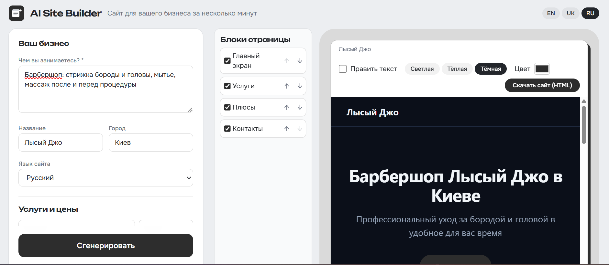

# AI Site Builder

Describe a small business in a few words, get a ready one-page website with working contact buttons. Edit the text in place, pick a theme, reorder blocks, and download everything as a single HTML file.

**Live demo:** https://ai-site-builder-amv.pages.dev  
**Status:** demo project (free-tier limits apply)



## What it does

- Form-based input: description, services and prices, contact channels (phone, email, WhatsApp, Telegram, Instagram), opening hours.
- AI writes the headlines, descriptions and benefits in one of 8 website languages.
- **Your facts stay yours:** services, prices and contacts are taken from the form and merged on the server, so the model can never invent a phone number or a price.
- Inline editing: click any text in the preview to change it.
- Three themes, accent color picker, block rail to hide or reorder sections.
- Export to a single standalone HTML file.
- Interface in English, Ukrainian and Russian.
- The interface re-tints itself to the accent color of the site being built.

## Engineering decisions

- **Structured output, validated:** the model returns JSON, which is checked against a zod schema. Invalid answers are rejected instead of rendered.
- **API key never reaches the browser:** requests go through a Cloudflare Pages Function. Visitors may also paste their own Gemini key; it stays in their browser.
- **Abuse protection:** per-visitor and global daily limits stored in Cloudflare KV (IPs are stored only as a short hash with a 25-hour expiry), origin check, request size limit, and a fail-closed mode when the counter storage is missing.
- **Region block:** the shared free quota is not offered in the EU/EEA, Switzerland and the UK, because the free Gemini tier is not allowed there.
- **Resilience:** retries on overload, a fallback model, and error codes that the UI translates into the visitor's language.
- **Privacy by design:** no accounts, generated pages are not stored. Phone, email and addresses are never sent to the AI.
- **Accessibility:** keyboard focus rings, reduced-motion support, labeled controls.

## Tech stack

React 19, TypeScript, Vite, Tailwind CSS 4, zod, Gemini API, Cloudflare Pages Functions and KV.

## Run locally

```bash
pnpm install
```

Create `.env.local` in the project root:

```
GEMINI_API_KEY=your_key
GEMINI_MODEL=gemini-3.1-flash-lite
```

```bash
pnpm dev
```

Before committing, run `pnpm build` (it type-checks the project).

## Deploy

Connect the repository to Cloudflare Pages: build command `pnpm run build`, output directory `dist`, `NODE_VERSION=22`. Add `GEMINI_API_KEY` as a secret and bind a KV namespace named `LIMITS`.

## Limitations

This is a demo, not a hosted website platform: sites are exported as files, there are no accounts, no image uploads and no multi-page sites. Free-tier quotas are small by design.

## Need a custom website, a Telegram bot or an AI integration?

Contact me: korochanskyyartem1998@gmail.com

Code: https://github.com/Artem18071998/ai-site-builder